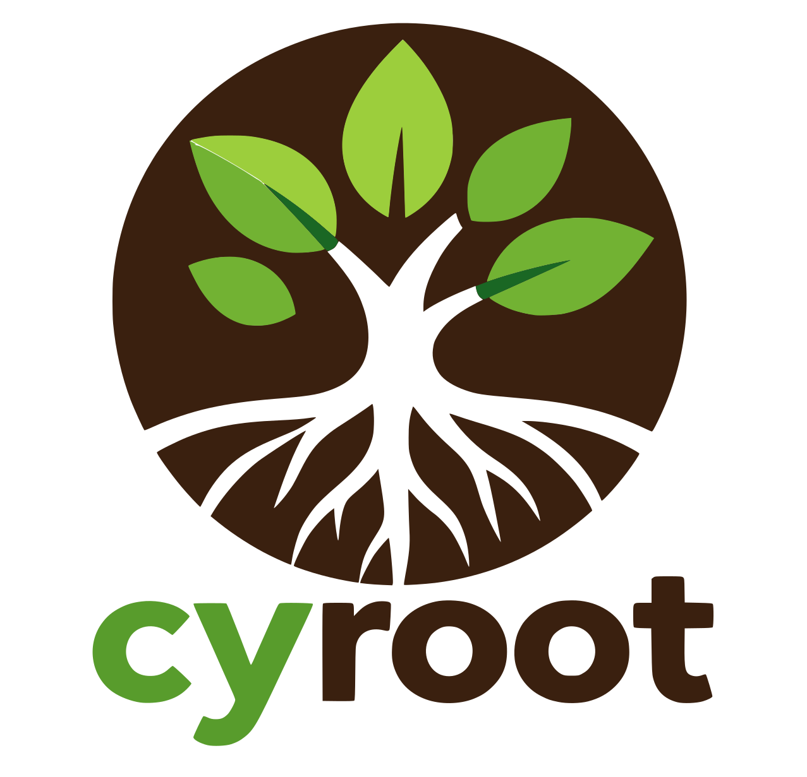
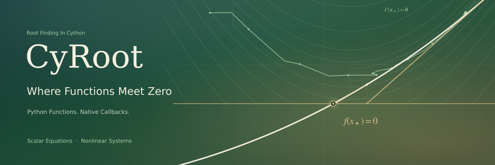
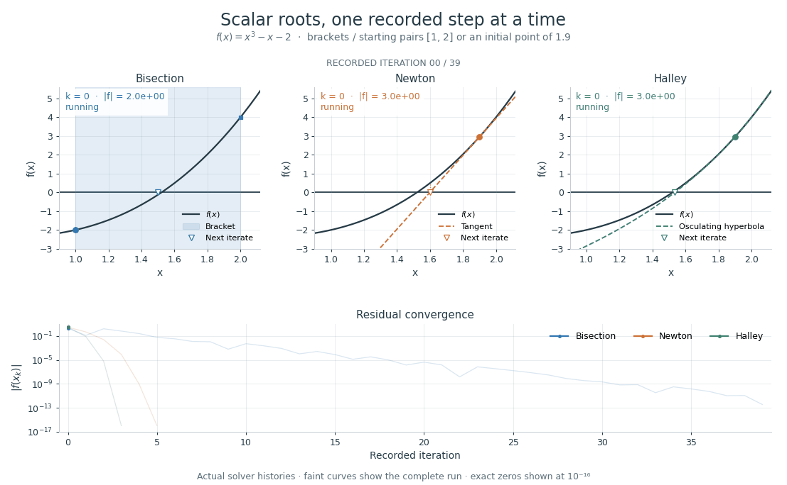
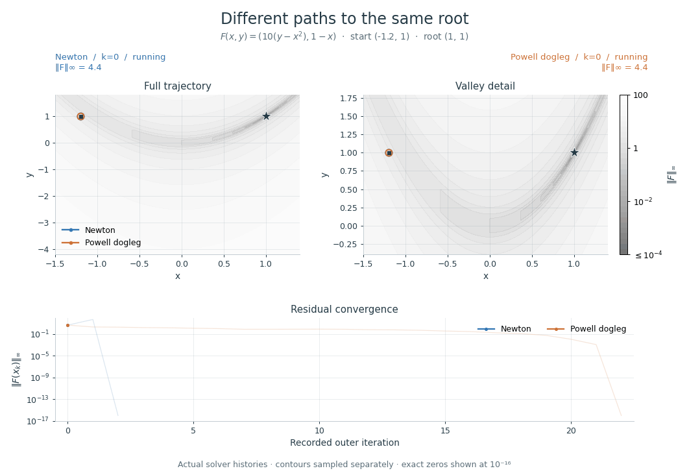
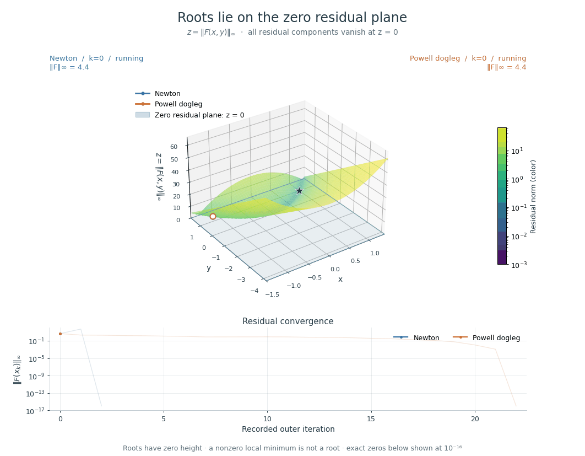

# <picture><source media="(prefers-color-scheme: dark)" srcset="assets/cyroot_logo-dark.svg" /></picture> CyRoot

[](https://github.com/inspiros/cy-root/actions/workflows/tests.yml)
[](https://github.com/inspiros/cy-root/actions/workflows/build_wheels.yml)
[](https://pypi.org/project/cy-root/)
[](https://pepy.tech/project/cy-root)
[](LICENSE)

<p align="center">
  
</p>

**Root finding in Cython. Python callbacks when convenient, native callbacks when speed matters.**

`cy-root` solves scalar equations and nonlinear systems with bracketing,
Newton-type, quasi-Newton, and optimization-based methods. It combines a broad
algorithm selection with resumable solvers, bounded iteration histories, and
analytic or numerical derivatives.

- **Start in Python.** Pass ordinary functions; vector callbacks receive tuples and can return sequences or NumPy arrays.
- **Compile the hot path.** Native callback adapters let Cython/C++ consumers execute the numerical loops without the GIL. Python callbacks still acquire it.
- **Inspect each iteration.** Run to completion or step through a solver, with copied states, call counts, and explicit stopping reasons.
- **Use higher derivatives.** Scalar Householder uses a native runtime-order recurrence; vector derivative plans include Jacobians, Hessians, and higher mixed partials.

> The examples below use the 2.0 API, which introduces breaking changes from 1.x.

## See The Iterations

### Scalar Equations

Bisection contracts a bracket; Newton follows a tangent; Halley uses second-order
information. The animation replays the actual solver histories for the same cubic.

<p align="center">
  
</p>

### Nonlinear Systems

Newton and Powell dogleg start at the same point on a curved residual valley.
Newton first moves outside the close-up; dogleg takes a longer path of smaller
steps. Both reach the root in this example.

<p align="center">
  
</p>

For a 3D view, plot the residual norm as height: $z=\|F(x,y)\|_\infty$.
The two horizontal axes are input coordinates. All residual components vanish
where the surface meets the **zero plane** ($z=0$). A positive local minimum
is not a root. Height is linear; surface colors use a logarithmic scale.

<details>
<summary>Watch The 3D Residual Surface</summary>
<p align="center">
  
</p>
</details>

These are iteration comparisons, not timing benchmarks. Derivative costs and
trial evaluations differ between methods. Background curves and contours are
sampled separately from the recorded solver calls.

Try different methods locally:

```bash
python -m pip install -e '.[examples]'
python examples/scalar_steps.py --methods brent secant householder
python examples/vector_steps.py --methods broyden lbfgs
python examples/vector_steps.py --view surface
```

The figures have sliders. Their rendering helpers live in
[examples/plotting.py](examples/plotting.py), outside the package API, and take
copied histories and plot callables. You can reuse them in a notebook or replace
them with your own plots. Jupyter is not required.

## Install

Install the 2.x release:

```bash
python -m pip install 'cy-root>=2,<3'
```

To build from a source checkout:

```bash
git clone https://github.com/inspiros/cy-root.git
cd cy-root
python -m pip install -e .
```

The source targets Python 3.11–3.14 and requires NumPy and SciPy. Building from
source also requires Cython 3.3.0, a C++17 compiler, and Python development
headers. SciPy supplies native BLAS/LAPACK; the numerical core can call these
without the GIL. See [building and testing](docs/building.md) for local checks.

## Documentation

Read the [manual](docs/README.md), [choose a method](docs/choosing-methods.md),
or build the [documentation website](docs/site/README.md). The manual covers
native callbacks, numerical derivatives, and the shared stopping rules.

## Quick Start

### A Scalar Root

```python
from cyroot import bisect, newton


def f(x):
    return x*x - 2.


bracketed = bisect(f, 1., 2.)
analytic = newton(f, lambda x: 2*x, 1.5)
numerical = newton(f, None, 1.5)  # Native finite-difference plan.

assert bracketed.success and analytic.success and numerical.success
print(analytic.root)  # Approximately 1.414213562373095.
```

Algorithm controls and stopping tolerances are keyword-only. Newton-type and
optimization-based entry points keep the function, derivative providers, and
starting point in that order; use `None` for a numerical derivative.

### A Vector Root, Including Rectangular Systems

```python
from cyroot import generalized_newton


def residual(point):
    x, y = point
    return (x - 1., y - 2., x + y - 3.)


result = generalized_newton(residual, None, (0., 0.))
assert result.success
print(result.root)  # Approximately (1., 2.).
```

Here the Jacobian has three rows and two columns: three residuals, two unknowns.
Newton uses a rank-aware least-squares step for rectangular systems. Shape
support depends on the method; Broyden and several other quasi-Newton methods
expect square systems.

### Native Callbacks

From a source checkout, compile the [typed Python example](examples/pure_python_callback.md):

```bash
python -m pip install Cython==3.3.0 setuptools
cd examples
python pure_python_callback_setup.py build_ext --inplace
```

Then pass its native callback descriptors to the same Newton interface:

```python
from cyroot import newton
import pure_python_callback as native

result = newton(native.callback(), native.derivative_callback(), 1.5)
assert result.success
assert abs(result.root - 2.**.5) < 1e-10
```

The example compiles `x*x - 2` and `2*x` into native functions. Its small ABI
bridges let the solver call them without the GIL. Passing the compiled Python
wrapper `native.residual` directly still uses Python's call machinery. This is
ahead-of-time compilation; CyRoot does not JIT-compile arbitrary Python functions.

### Higher-Order And Optimization-Based Methods

```python
from cyroot import halley, householder, scalar_lbfgs

f = lambda x: x*x - 2.

third_order = halley(f, lambda x: 2*x, lambda x: 2., 1.5)
higher_order = householder(f, None, 1.5, d=4)
optimized = scalar_lbfgs(f, lambda x: 2*x, 1.5)

assert third_order.success and higher_order.success and optimized.success
```

The optimization family minimizes a residual objective and then checks the
original root tolerance. A stationary point with a nonzero residual is reported
as a failure to find a root. Scalar and vector conveniences are available for
Levenberg–Marquardt, BFGS, L-BFGS, and Powell dogleg. An
[external-optimizer bridge](examples/optimization_root.py) can also reuse a
residual objective and its transformed derivatives.

## Step, Inspect, Resume

```python
from cyroot import as_root_snapshot
from cyroot.native import Newton

solver = Newton(lambda x: x*x - 2., lambda x: 2*x, 1.5, history=32)
first = as_root_snapshot(solver.step())
final = as_root_snapshot(solver.run())
history = tuple(map(as_root_snapshot, solver.history))

assert final.residual_converged
assert history[-1].root == final.root
print(first.root, final.f_calls, final.termination_reason)
```

`RootSnapshot` provides common scalar/vector values and retains the original
record in `diagnostics`. History is bounded and opt-in; `history_truncated`
reports when the capacity was insufficient. Hybisect's multi-root searches keep
a separate search/event interface.

Check the stopping reason as well as `success`: scalar bracket convergence can
establish success before the residual meets its tolerance.
`residual_converged` distinguishes those outcomes. Precision stagnation and
optimizer stationarity do not by themselves establish a residual root.

## Algorithms

| Family | Scalar equations | Vector systems |
| --- | --- | --- |
| Bracketing | Bisection, Hybisect, regula falsi, Illinois, Pegasus, Anderson–Björck, Dekker, Brent, Chandrupatla, Ridders, TOMS748, Wu, ITP | Vrahatis sign-polygon bisection |
| Newton-type | Newton, damped Newton, Homeier, Halley, Super-Halley, Chebyshev, tangent hyperbolas, runtime-order Householder | Generalized Newton, damped Newton, matrix-free Newton–Krylov (GMRES/LSQR), Halley, Super-Halley, Chebyshev, tangent hyperbolas |
| Quasi-Newton / interpolation | Secant, Sidi, Steffensen, inverse quadratic interpolation, hyperbolic interpolation, complex Muller | Wolfe–Bittner, Robinson, Barnes, Traub–Steffensen, good/bad Broyden, Klement |
| Optimization-based | Levenberg–Marquardt, BFGS, L-BFGS, Powell dogleg | Levenberg–Marquardt, BFGS, L-BFGS, Powell dogleg |

Derivative plans support scalar derivatives and dense vector tensors of shape
`(outputs, inputs, ..., inputs)`, with memory and stencil budgets. Analytic and
numerical providers can be combined. Higher tensor orders have substantial
storage and sampling costs.

[Numerical derivative providers](docs/numerical-derivatives.md) include fixed
finite differences, adaptive Richardson refinement, and complex-step for
holomorphic residuals. Plans cover scalar derivatives, rectangular Jacobians,
full mixed Hessians, and higher tensors. See the
[numerical derivative example](examples/numerical_derivatives.py).

`SCALAR_ROOT_FINDING_METHODS` and `VECTOR_ROOT_FINDING_METHODS` expose supported
method names. Use direct functions or the `find_scalar_root` / `find_vector_root`
dispatchers.

## License

MIT licensed, see [LICENSE](LICENSE).
